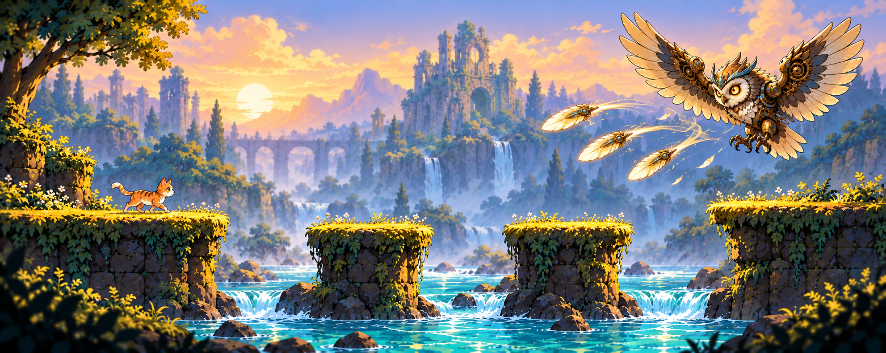

# LegendOfCat

A charming 2D adventure starring **Mika the cat**. A little cat, a big adventure: LegendOfCat is being built around beautifully painted worlds, tricky jumps and memorable boss encounters.

## Download (early development)

| Platform | Download |
| --- | --- |
| Windows x64 — installer (recommended) | [Download Windows Installer](https://github.com/LeonHorner/LegendOfCat/releases/latest/download/LegendOfCat-Windows-Installer.exe) |
| Linux x64 — AppImage | [Download Linux AppImage](https://github.com/LeonHorner/LegendOfCat/releases/latest/download/LegendOfCat-Linux-x86_64.AppImage) |
| Windows x64 — portable (optional) | [Download Portable ZIP](https://github.com/LeonHorner/LegendOfCat/releases/latest/download/LegendOfCat-Windows-Portable.zip) |

These builds are **unfinished previews**, not the complete game. Downloads are unsigned and graphical installation / version-to-version updates still need real Windows and Linux verification. If a direct link is not yet available during the transition to the new asset names, use the [latest release page](https://github.com/LeonHorner/LegendOfCat/releases/latest).

*Golden River Ruins — early concept art, not a gameplay screenshot. Final environments and encounters may change. [Art direction and provenance](docs/design/art-direction.md).*

## An adventure in the making

The planned adventure brings together:

- **Mika**, an orange-and-cream cat with graceful movement and a curious spirit.
- **Atmospheric 2D worlds**, with warm painted scenery and clearly readable paths and hazards.
- **Satisfying movement and challenges**, built around responsive running, jumping and smooth animation.
- **Distinctive boss encounters**, including a grounded foe, a flying clockwork owl and a dragon.

These are development goals. The six-level journey, combat and final level designs are still being developed; the concepts do not represent a finished, playable campaign.

## Development status

LegendOfCat is in early development in Unity. The current foundation includes a playable movement prototype, a start menu, settings and update integration. The adventure described above is not yet available as a complete game.

**Windows x64 and Linux x64 are the target platforms.** See the [release notes](https://github.com/LeonHorner/LegendOfCat/releases/latest) for shipped features, limitations and previous builds. On Linux, make the downloaded AppImage executable before running it. Settings and future saves are stored outside the installation so updates do not overwrite them.

## Feedback

Found a bug or have an idea for Mika's adventure? [Open an issue](https://github.com/LeonHorner/LegendOfCat/issues).

Bug reports and feature requests are welcome. External pull requests are not accepted; see [CONTRIBUTING.md](CONTRIBUTING.md).

## Behind the adventure

- [Game direction](docs/design/game-direction.md), [art direction](docs/design/art-direction.md) and [implementation roadmap](docs/design/implementation-plan.md)
- [Development and local setup](docs/development.md)
- [Release and update documentation](docs/releasing.md)

## License

Original code is licensed under [PolyForm Noncommercial 1.0.0](LICENSE). Original artwork, audio and models, where copyright exists, are licensed under [CC BY-NC 4.0](ASSET-LICENSE.md). Third-party components retain their own licenses. See [asset provenance](ASSETS.md) for sources and creative direction.
