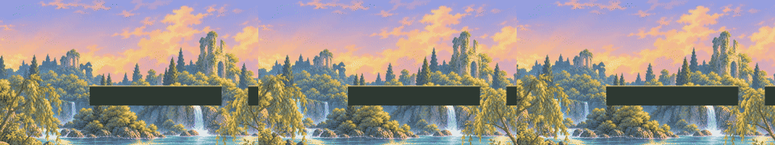

# Golden River background decision lab

Issue [#50](https://github.com/LeonHorner/LegendOfCat/issues/50). Bounded prototype;
production selection is pending user review. No final Level 1 direction is approved.

## Coordination and scope

Ownership: the isolated BackgroundStudy runtime, shader, Editor generator, tests,
its Resources/BackgroundStudy atlas, scene and this evidence directory. No overlap
with PR #51's Blender authoring. Existing Mika prefabs, movement motor, shared
course, menu, packages and project settings are consumed without changes.
Native blocked-by relationships were read: #50 has none, and #16 includes #50.
Base: main d01d470, including the merged Mika presentation from PR #45.

## Inspect and run

Use Unity 6000.3.27f1. Open `Assets/Game/Scenes/BackgroundStudy.unity` and press
Play. Alternatively use **LegendOfCat > Background study > Create isolated scene**.
A/D/arrows move, Space jumps, R retries. The lab preserves the original seven
platform positions, then adds seven more: **109 world units from x=-5 to x=104**,
more than twice the original 52-unit span. This remains a review route, not an
approved Level 1 layout. The camera
follows the interpolated cat transform with smoothing and viewport-aware bounds.
Like the existing movement course, the view is fixed to **16:9**, with black bars
outside that viewport in other window shapes. The camera baseline is y=1 instead
of y=3, exposing two more world units below the platforms; jump follow is similarly
lowered. Character scale, collisions and jump physics are unchanged.
Use the on-screen buttons to switch candidates without moving the camera or cat.
Camera-only tour travels at 5 units/s and reverses; turn it off to follow Mika.
Its one-way sweep is now 100 units (20 seconds, or 40 seconds there and back).
The last platform has broad safe ground; reverse direction to test return travel.

Ten land masses extend to y=-10, below the visible play area, with painted dark
stone/earth and a naturally lit grass cap. Four narrower jump platforms have
tapered irregular rock undersides using the same painting. The contact line lies
inside a narrow painted grass band, with the visible front rim 0.12 units below
the unchanged BoxCollider2D contact and the back edge 0.10–0.13 units above it.
This keeps Mika within the turf rather than balancing on the front rim. Shared movement
course assets, Mika and motor values are unchanged. Floating terrain here means
stationary suspended rocks, not moving supports or a new traversal mechanic.
Sparse dark foliage frames the lower left/right corners like the README reference.
It is camera-relative decoration without collision. Each source half is scaled
proportionally into its own 4.5x6-unit corner quad; only the authored low foliage
is opaque, leaving the center and landing plane open. Natural leaf contours are
retained instead of clipping a straight top edge. All three candidates share it.
The river now uses **one connected river-and-bank painting** from its distant
waterfalls to its nearest stones. The middle depth's three quads share one texture,
material, UV layout, scale and motion. Their low-water compositing pass samples
the exact same pixels to cover the cliff bases around y=-3.4; no independent
foreground-water graphic or scroll factor remains. Sky and near foliage can
still parallax separately. The river is decorative, not a swimming/collision
surface. Corner plants and platform vegetation remain separate natural cutouts.
User review on 2026-10-27 rejected the high foreground water, broad slab-like top
faces and front-rim stance. A subsequent 16-unit foreground river was also rejected
for looking disconnected from the background water. It has been superseded by
the single 24-unit-tiled `connected-river.png` composition. The
surfaces are approximately 0.22–0.25 units deep instead of 0.38–0.58; almost-square
fronts and reduced side shading retain the concept's painted 2D character. Larger
rock motifs, a shared warm olive palette and mipmapped ground textures reduce the
separate, highly tiled look. These refinements are candidates for another review,
not a claim that the artwork now matches the concept or has been accepted.
Each platform receives one to three ivy/moss/fern patches from three cutouts,
with different lengths, positions and facing. Rock tint, texture registration,
floating underside shape and apparent top depth also vary. The shallow visible
upper band surrounds the collision contact line; it adds restrained painted depth
without changing the 2D motor or prescribing 3D gameplay. Geometry remains
a bounded readability prototype, not approved final terrain art.

| Candidate | Far / middle / near travel | Depth and readability | Variety and effort |
| --- | --- | --- | --- |
| A: Three layers | 0.08 / 0.28 / 0.55 | Strongest separation; near scenery moves noticeably. | Three authored layer families; reusable scenery needs asymmetric variants and occasional unique landmarks. |
| B: Panorama | 0.08 / 0.08 / 0.08 | All scenery travels together; calm painted vista with no relative depth. | Cheapest composition; recognizable towers stay on screen longer, but extended travel needs additional panoramas. |
| C: Subtle layers | 0.05 / 0.14 / 0.24 | Less motion distraction while retaining relative depth. | Same art cost as A; longer time before recognizable scenery repeats. |

Values mean scenery travel relative to camera: 0 stays on screen, 1 stays in
world coordinates. They are prototype tuning, not approved production settings.
Sliders affect A; B/C are fixed comparisons. All collision geometry remains in
world coordinates. No scenery has colliders. No asset suggests a bridge across a
gameplay gap; crisp lit tops and dark solid platform fronts identify landing edges.

## Reuse and limitations

The new generated atlas reinterprets the archived reference into three panoramic
strips; the original full scene is never used as a tiling layer. The initial broad
vertical alpha fades were rejected during user testing on 2026-10-25 for blurry
transitions. Only the sky strip remains in use. New independent transparent middle
and near paintings preserve their authored contours, with low-alpha generation
halos rejected by a narrow alpha threshold. No screen-height crossfade remains.
All paintings retain their original aspect ratios. Lower, smaller near vegetation
leaves the river visible and avoids filling the gameplay gaps with giant shrubs.
Alternating mirrored tiles meet with identical edge pixels; three 64-unit sky tiles
and three 24-unit tiles per cutout depth cover the view. Absolute offsets prevent reversal drift. Mirroring
removes color discontinuities but can reveal symmetric tree/tower silhouettes;
it is a technical reuse demonstration, not acceptable variety for a full 4–6-minute
level. Production should use deliberately matching painted edges and multiple
modules, with unique landmarks placed in world space behind the gameplay plane.

Nine unlit quads use three 1536x1024 uncompressed textures (approximately 18 MiB RGBA
before platform overhead) and three materials. Transparent overlap adds overdraw;
no measured player GPU timings or platform performance claim is made.
The terrain meshes share an additional opaque turf/stone painting and material;
two transparent corner quads add one shared framing texture/material. These are prototype
assets with provenance and prompts in ASSETS.md and terrain-and-corner-prompts.md.
The three river quads (already counted among the nine depth quads) use an additional
low-water compositing pass. Fourteen shallow upper faces and twenty-seven
hanging-foliage quads add overlap/draw work. No measured GPU or target-device
performance is claimed. The old middle-cutout and foreground-river paintings are
retained as superseded sources and are not loaded by this lab. See
connected-river-prompt.md for the new painting and depth-and-foliage-prompts.md for
the retained meadow and hanging-vegetation sources.

## Evidence and decision

Capture reproducibly with **LegendOfCat > Background study > Capture comparison**
(requires a graphics device). Candidate images use the same camera, cat pose and
platforms. Small grayscale captures are 640x360 with luminance conversion.
Then run `pwsh -File tools/export-background-study.ps1` with FFmpeg available to
encode the MP4s and comparison GIF and remove the numbered intermediate PNGs.
Intermediate frames now live under ignored `Logs/background-study-motion/`;
existing manually captured frames under the documentation folder are left alone.
Motion sequences use the same 5-unit/s camera sweep, reverse and return; they are
camera/scenery recordings, not recordings of player input. Wrap stress stills
inspect negative travel, several world positions and long travel. Unit tests sweep
both tile widths across positive and negative wrap boundaries.

| Evidence | A: Three layers | B: Panorama | C: Subtle layers |
| --- | --- | --- | --- |
| Color | [1280x720](candidate-0.png) | [1280x720](candidate-1.png) | [1280x720](candidate-2.png) |
| Small grayscale | [640x360](candidate-0-small-grayscale.png) | [640x360](candidate-1-small-grayscale.png) | [640x360](candidate-2-small-grayscale.png) |
| Camera sweep and reversal | [MP4](candidate-0.mp4) | [MP4](candidate-1.mp4) | [MP4](candidate-2.mp4) |

Review observations: A has the clearest relative motion, but its nearest vegetation
pulls more attention toward the bottom of the view. B is calm and inexpensive but
flattens spatial depth; its distant landmarks barely move over the short segment.
C retains separation with less motion competing with landings. All three preserve
the crisp dark platform silhouettes in the small grayscale stills; Mika's silhouette
remains visible, though its value separation against pale foliage is modest and
needs another gameplay review with final art. The camera sweep shows scenery
moving behind gaps, never moving the platform edges. It is a camera-only sweep,
so it does not establish readability during a complete player traversal.

Wrap stress captures reveal symmetric tree clusters around mirrored joins. No
empty horizontal tile gaps appear; recognizable repeated towers and mirrored
foliage remain an art limitation. The old strip fades caused ghosted landmark
silhouettes and have been replaced with independently generated cutout layers.
Variant modules are still required before production. The initial panorama capture exposed a bare strip at
the lower screen edge; enlarged vertical coverage and camera-locked vertical
registration address that. Horizontal parallax is the only evaluated motion axis.

Recommendation for user consideration: **C, subtle three-layer parallax**, with
occasional unique world-space landmarks for route identity. It retains the reuse
and depth of A at a calmer apparent speed. This recommendation does not authorize
production. Choose A for stronger depth or B for a quieter moving painting.

Recordings are reproducible Unity camera renders sampled at **5 fps**, not a
real-time performance capture. Use Play mode to judge frame pacing at the actual
display refresh rate. Smooth follow uses elapsed time; automated tests establish
registration and collision separation, not perceived smoothness or art acceptance.

Validation: pinned Editor import/scene generation and graphics captures succeeded;
Eight focused Unity tests cover ground contact, world-space collision stability
through all concept switches, tile coverage and fixed 16:9 at 640x360, 1280x720,
1024x768 and 2560x1080, the at-least-double course span, matching terrain contact
lips/grass-band registration, varied hanging greenery and one shared river source
without separate foreground-water graphics. The extended
revision is rendered/tested in an ignored isolated project copy under artifacts/
while the working Editor is open, with a separate Library. Test logs are
local under ignored Logs/. No Windows/Linux player/launcher build, actual install
test or measured GPU performance is claimed. Package lock remained unchanged
after Editor import. Keep the PR draft and issue open until the user chooses and
that choice is recorded in art-direction.md. Full merge validation is deferred
while this acceptance criterion remains unfinished.
