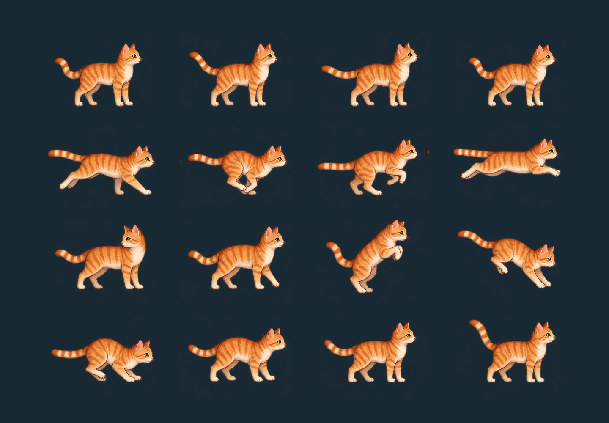

# Mika character authoring

Issue #10 is in progress. This is isolated authoring work, **not accepted production artwork**.

## Current prototype: original four-frame run (2026-10-24)

After comparing animated loops, the user preferred the first four run drawings
and explicitly requested their integration into the movement prototype. The
course now loads the Editor-generated `Resources/MikaOriginal.prefab`, using
original candidate poses 4–7, driven by measured travel over the original 2.4 m
stride. No generated inbetweens, optical flow or cutout rig is used in this path.
Idle uses a stable original pose; jump/fall/turn/landing use the original candidate
poses as temporary companions, not newly accepted animation. Visible sole pivots
and the existing visual-only floor alignment correct the old hovering offset.

`LegendOfCat/Mika/Create isolated character preview` prepares the original assets
and opens a temporary movement-course scene. Press Play to test. The preparation
menu can regenerate the prefab and sprite metadata without changing a scene.
MovementCourse integration belongs to this feature after #36/#37 merged; camera,
viewport, HUD, physics and input stay owned by their existing implementations.
The old eight-pose, optical-flow, rig and sixteen-pose studies below remain
historical. This approval covers the four-frame prototype, not completion of #10.

## Current decision: rig rejected; restart with a reviewed run loop (2026-10-24)

The user explicitly rejected the articulated revision as substantially worse:
feet/legs are much too thin and the jump animation is inappropriate. The earlier
optical-flow running experiment was also rejected. These attempts are retained
as negative examples and provenance, not accepted artwork or a production base.

The user agreed to return to complete-character frame animation. First finish a
consistently drawn run cycle matching the earlier complete-cat visual reference,
with stable anatomy, adequate paw size, registration and clear support contacts.
Show it as a short loop, also slowed down, for review **before gameplay integration**.
Then author coherent takeoff, flight/apex, descent and landing image sequences.
Do not repeat optical-flow smoothing or tune the rejected procedural rig as the
default next step. A future rig would require a new user decision and artwork
actually designed for it, not reuse of these unsuitable generated parts.

Passing five mechanical tests and the recorded reach/contact metrics below did
not validate visual quality. The user rejection takes precedence over those earlier
technical results and optimistic progress descriptions. Read the authoritative
[animation decision](../art-direction.md#mika-animation-decision--2026-10-24).

Historical status at the rejection decision: code/assets were preserved and the
preview command still opened the rejected rig. The current command is superseded
by the four-frame prototype above. The MP4, PNGs, prefabs, prompts and
source sheets below are historical evidence. Do not present them as the approved
target, integrate them into the course, close #10 or mark PR #41 ready based on them.
A [complete-character run study](frame-run-study/README.md) now includes normal
and slowed loops. It restores fuller paws but still has inconsistent proportions
and stride spacing; it is not an accepted replacement or integrated into Unity.

At rest all four paws must meet the surface; in a run, support paws stay planted
while swing paws lift intentionally. Do not force every running paw onto the floor
or alter physics/input timing to conceal a cosmetic contact problem.

## Rejected articulated revision — historical implementation (2026-10-24)

The default isolated preview now uses a small cutout rig with independent upper
legs, lower legs, paws, torso/head and tail. The earlier pose/optical-flow experiments
remain archived and are not used by the default preview. **Create archived sprite
preview** opens the previous experiment explicitly.

`MikaGait` keeps support feet in world coordinates and moves swing feet through a
smooth low arc. Diagonal pairs alternate; all four soles are grounded at rest.
The gait follows travelled distance. Stopping finishes the current swing before
planting the paw. A two-bone solve bends joints while preserving segment lengths.
Jump targets fold and extend continuously with vertical speed. Landing lowers the
torso through leg flexion, without scaling the body or affecting input/collision.
The visual root compensates for the physics contact skin at the detected surface.

**Record articulated movement review** simulates the existing controller in a
separate local Physics2D scene and records 360 Camera.Render frames at 60 Hz under
ignored `Logs/mika-rig-recording/`. It does not simulate or replace an open scene.
The reviewed sequence includes idle, running, reversal, held and short jumps,
landing and stopping. This is visual authoring playback, not the full test suite.

Provenance: `mika-rig-source.png` was generated with the built-in OpenAI image tool
on 2026-10-24 using the earlier original Mika sheet as identity reference; exact
model ID was not exposed. `tools/prepare-mika-rig.py` extracts eight parts, cleans
alpha specks and registers bone axes under the user's local-edit authorization.
Pillow/numpy/OpenCV remain authoring-only tools. `rig-part-*.png` and the
Editor-generated `MikaRigCandidate.prefab` use `ASSET-LICENSE.md` where rights
exist; no third-party character/font/music asset is imported. Human direction:
natural orange/cream quadruped, smooth movement, planted paw contacts. Implementation
decisions: fixed torso/head shape, fixed-length limbs, diagonal support pattern,
and restrained tail motion. Prompt: [rig-generation-prompt.txt](rig-generation-prompt.txt).

The user subsequently rejected this rig. Its technical results below are retained
for diagnosis only and do not override that decision.

Validation of the articulated revision: Unity compilation/import passed; the five
focused `MikaGaitTests` passed (5/5, zero failures). Tests cover all four resting
soles, no sliding during stance, alternating support, stopping, fixed bone lengths
and carrying airborne paws with the root. A final 360-frame controller/local-physics
review after current-main integration reported maximum ankle reach error 0.00000 m
and grounded sole offset 0.00500 m (the intentional 5 mm visual overlap to hide the
physics skin gap). No full suite or Windows/Linux builds were run for this draft.

The [60 Hz movement recording](rig-movement-review.mp4) shows idle, run, reversal,
held jump, short jump, landing and stopping. [Selected frames](rig-review-strip.png)
support comparison. `rig-standing.png` shows all four resting paws on the floor;
`rig-running.png` shows the alternating support/swing pose. No runtime optical-flow
or pose crossfade is used. These captures are actual Unity rendering, not generated
motion illustrations. The original and circle-cleaned source sheets remain archived.

## Rejected sprite/optical-flow preview — historical implementation (2026-10-24)

The earlier sprite preview used `mika-movement-smooth.png`: 24 original generated key
poses plus 54 optical-flow intermediate images. Following user review, running
uses only the eight original contact/passing poses: optical-flow leg inbetweens
made the run look worse and are no longer selected. Further run smoothing needs
authored inbetweens with consistent anatomy and foot contacts, not optical flow.
Jump/fall use progressive velocity-dependent poses with a shared apex;
landing uses contact, absorption and recovery over 0.24 seconds. Idle holds one
registered pose to avoid the old size/foot-position flicker. These changes supersede
the initial 16-frame candidate described below.

The visual child aligns its opaque sole pivot to the surface detected by the
existing collider cast, compensating for the physics contact gap without moving
the Rigidbody or collider. Grounded pivots are measured independently per frame.
Airborne torso anchors stay fixed to avoid pulling tucked feet toward the ground.

Updated provenance: built-in OpenAI image generation, exact model ID not exposed,
generated 2026-10-23, refined/imported 2026-10-24. The user requested planted paws
and smoother jump/landing movement and explicitly authorized local image cleanup.
`mika-movement-refined-source.png` preserves the generated 6-by-4 source.
`tools/prepare-mika-sprites.py` removes isolated alpha specks and registers unscaled
poses; `tools/interpolate-mika-sprites.py` uses Pillow, numpy and OpenCV DIS optical
flow to produce the review atlas. These are authoring tools only, not new Unity
runtime dependencies. Asset terms remain `ASSET-LICENSE.md` where rights exist.
Optical-flow images need motion review for local distortions and ghosting before
production acceptance; they are not hand-authored final animation.

Unity compiled/imported the revised preview and regenerated the sprite assets and
prefab. The preview runs locally; standing paw contact was inspected. Automated
tests, full movement recording and both platform builds remain pending. The old
contact sheet below records the earlier candidate, not the revised atlas.

## Ownership and integration

PR #36 and PR #37 are now merged. With explicit user authorization, current main
was merged normally into `feat/mika-animation`; no feature PR was merged into main
by this task. Their window, icon, update and release changes are preserved. Mika
provenance is now appended to `ASSETS.md`. The rejected character stays isolated as
historical evidence; `MovementCourse.cs` is not modified. The replacement requires
run-loop review before integration.

`feat/mika-animation` owns `MikaAnimation.cs`, `MikaSpritePresentation.cs`,
`MikaCharacterPreview.cs`, `MikaAnimationTests.cs`, `Assets/Game/Art/Mika/` and this
directory. PR #36 retains `MovementCourse.cs`, camera/display integration and its
`ASSETS.md` changes. PR #37 retains launcher/release/update workflows. Coordination
notes were posted on both PRs before edits. No shared scene, prefab, package,
project setting, movement rule, controller or input implementation is modified.

After character acceptance, the character branch owner should preserve #36's
framing/HUD changes when replacing temporary course geometry with a cosmetic child.
Do not replace shared files wholesale or merge the character PR without authorization.

## Initial sprite preview and presentation — historical implementation

Use Unity 6000.3.27f1 and **LegendOfCat > Mika > Create isolated character preview**.
The command imports the candidate uncompressed with alpha, creates sixteen
registered sprite assets and a dedicated candidate prefab, then opens an unsaved
preview scene after offering to save existing work. It does not modify the movement
course. Enter Play mode and use A/D, jump and retry controls from `CatInput`.

`MikaAnimation` selects idle, run, turn, jump, fall and landing. The adapter observes
the existing controller, measured horizontal displacement and grounded state.
Facing changes immediately. Ground flourishes cannot delay a jump. Gait phase
uses distance (provisional 2.4 m stride), avoiding clock-driven running against a
wall. Retry resets presentation history. Sprite flipping never scales the body,
collider or whole character. No animation event controls gameplay or hit timing.
The component must live on a visual child, never the physics root.

These rules do not establish that the candidate's painted feet are stationary:
source registration and authored contact phases still require correction and
motion review. Four run frames are an authoring candidate, not a claim of smooth
final animation. Airborne frames and turn silhouettes also need proportion review.

## Remaining acceptance work

- Create a replacement consistently drawn complete-character run cycle; do not
  treat cleanup of the rejected rig or optical-flow frames as the agreed solution.
- Review the run as a short loop, also slowed down, before gameplay integration.
- After review, author coherent jump/flight/landing sequences and their transitions.
- Integrate accepted artwork while preserving #36's framing/HUD and update provenance.
- Record actual movement, short/buffered jumps, reversal, fall, landing and retry.
  Inspect normal, small-window and grayscale views against light and dark backdrops.
- Run exact-head final Prepare merge checks and both platform builds when complete.

No extra idle/fish behavior, new ability, combat timing or campaign decision is introduced.

## Initial sprite asset provenance — historical record

Asset: `Assets/Game/Art/Mika/mika-movement-candidate.png` and Editor-derived frames.
Source: built-in OpenAI image generation, 2026-10-23 (Europe/Vienna); exact model ID
not exposed. License/terms: `ASSET-LICENSE.md` where rights exist; generation does
not establish exclusivity. No third-party asset, character, font or music imported.
Editor slicing is lossless and retains source alpha. Human direction selected
natural orange-and-cream quadruped proportions, modest head/eyes and striped tail
from archived references. Implementation choices: side-on right-facing poses,
seven movement states, cosmetic separation, no extra idle/fish behaviors. The first
generated variant was rejected for crowded cells; the retained second variant
still needs cleanup and is explicitly a candidate. The source generation prompt
is archived in [generation-prompt.txt](generation-prompt.txt).

The earlier shared-file deferral is superseded: provenance and the rejection status
are now recorded in `ASSETS.md`. Issue #10 remains incomplete.

## Initial sprite validation and capture — historical record

Unity 6000.3.27f1 compiled the runtime, Editor and test assemblies and completed
candidate import/prefab generation successfully. `Packages/packages-lock.json`
was unchanged after import. The source/documentation whitespace check passed;
the complete diff reports Unity-generated empty-field trailing spaces in metadata,
sprites and the prefab, which are preserved as generated. Tests were added but not
executed; no player/launcher builds or full final validation were run for this
unfinished draft.

This is an actual Unity Camera.Render capture, created by **LegendOfCat > Mika >
Capture candidate contact sheet**, not a movement recording. Rows show idle, run,
turn/jump/fall and landing/recovery candidates. The source sheet's uneven margins
cause cropped tails and stray neighbor pixels in the run row; ground registration
and proportions also vary. Do not use this candidate in the live course.

Capture provenance: local Unity rendering of the generated sprites on 2026-10-23,
no additional generator, under `ASSET-LICENSE.md` where rights exist. The plain dark
backdrop supports edge inspection; it does not establish light-background, small
window, grayscale or motion acceptance. Append this capture provenance to
`ASSETS.md` along with the character entry at integration.
