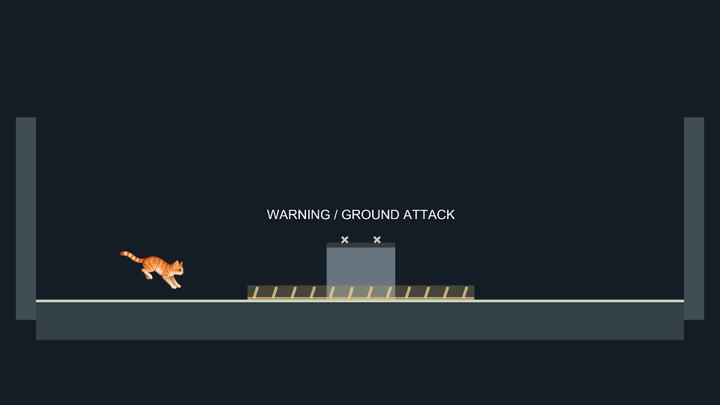
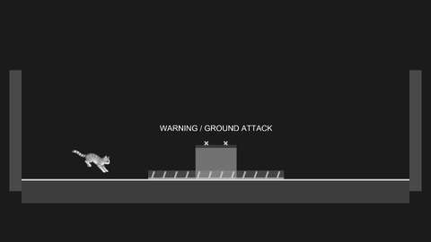

# Stomp encounter prototype

Issue #12. Enter **Stomp lab (prototype)** from the main menu. The isolated greybox reuses CatController, CatMotion, CatInput, RunLifecycle and MikaOriginal. It adds no campaign, save format, new health UI or traversal ability.

## Current encounter

- Warning: 1.2 seconds, striped ground band and closed dark head.
- Attack: 0.35 seconds, solid ground band and closed head.
- Recovery: 1.8 seconds, white vulnerable head. Descending feet must cross its top; side/body contact still hurts.
- The target moves in every phase, including recovery: x = 2 sin(0.6 t), radius 2 and maximum speed 1.2 units/second. Warnings, ground hazard and labels follow its actual position. Sweeps use relative player/target movement.
- A valid stomp removes one of three target health points, bounces Mika upward at 10 units/second and restarts the attack cycle without resetting patrol position.

The timing, patrol and health values remain prototype tuning for user review. A later production boss, phases, art and complex attack patterns belong to #18.

## Damage feedback selected for this revision

Damage preserves horizontal velocity and applies only an upward velocity of 7 units/second. Held movement remains active; no forced direction change, horizontal stop, lateral impulse or teleport occurs. Releasing jump does not shorten the automatic hop. Side contact, closed-head contact and the active ground band can cause damage.

A small original irregular cream contact burst with a feathered warm rim and three tapered brush strokes opens and fades over 0.15 seconds. It appears on the contacted boss/hazard surface at the collision sample, stays at that arena-space point instead of following either character, and has no collider. High-speed crossings use the swept contact; existing overlaps use the nearest surface point. The burst uses native mesh geometry with a vertex-alpha feathered rim and contains no imported image. Its brief opening changes width/height separately and rotates slightly; the smaller strokes travel out and taper away. A reduced 35%-strength white flash fades over 80 ms so it does not compete with the star. No camera shake or hitstop is added.

Damage gives 1.25 seconds of protection. Mika gently pulses between original and half opacity every 0.25 seconds and never disappears. Protected contact causes no extra damage, hop or effect restart. Pause freezes physics, combat and effects. Retry/restart clear all transient feedback and restore the original sprite color. Effects finish fading after a terminal hit; win/loss retain Retry and Menu.

The previous lateral recoil and falling sine tone were rejected by the user. They are removed from active gameplay. Accepted damage now plays the selected 0.9-second real-cat vocal once, at AudioSource volume 0.5. Protected contacts do not retrigger it. Pause/resume pauses/resumes playback; retry, restart and leaving the arena stop it. The old `damage-tone.wav` is retained solely as a rejected historical preview.

## Selected real-cat damage voice

The user rejected the abstract proposals, the attention-seeking cat-meow reference and the 420 ms performed human-voice candidate (too short and insufficiently cat-like). The current direction is a real-cat vocalization with a rough abrupt beginning and a recognizable longer ending.

The user selected the second version (0.9 seconds) on 2026-10-31. Review excerpts of **Cat Angry Meow.WAV** by **softcoresoft**, [Freesound](https://freesound.org/people/softcoresoft/sounds/327438/), [CC BY 4.0](https://creativecommons.org/licenses/by/4.0/):

- [Natural-speed excerpt, 1.2 seconds](sound-options/real-cat/natural-reaction.wav).
- [Shorter excerpt, 0.9 seconds](sound-options/real-cat/short-reaction.wav): same phrase accelerated with pitch preserved, rather than an earlier cut.

[Attribution, license, modifications and source hashes](sound-options/real-cat/README.md) accompany the retained public source preview. The 0.9-second version is copied unchanged to `Assets/Game/Resources/StompDamageVoice.wav` and loaded through Resources. Import settings preload uncompressed PCM to avoid a first-hit decode/load delay. The source describes actual hissing/meowing; the user selected its damage-feedback fit. The prior performed-voice clip remains in sound-options/cat-reaction solely as rejected history.

## Rejected abstract sound proposals

These three rejected original unpitched noise-based proposals have comparable RMS level and quiet peak limits. They contain no external recordings, cat vocalizations, melody or pitch glide. Reproduce them with `python tools/generate-stomp-sound-previews.py`; the deterministic generator documents synthesis and envelope choices. None is wired into gameplay. They remain solely as rejected review history.

1. [Soft impact](sound-options/soft-impact.wav): low, softly damped impact, 120 ms.
2. [Muted tap](sound-options/muted-tap.wav): shorter, slightly clearer tap, 85 ms.
3. [Soft rustle](sound-options/soft-rustle.wav): airy fabric-like contact, 140 ms.

## Refined combat signals

Warning uses diagonal hatching, a low footprint edge and increasingly close pulses. The closed head has two small cross marks in addition to its dark cap. The active ground attack replaces hatching with a solid band and short upright strike marks; every strike mark stays inside the actual 0..0.35-high hazard. Recovery removes the ground warning and replaces head crosses with two downward chevrons over the existing white contact edge. Marks track the moving target; their visibility changes directly with combat phase, including the exact open/closed transition. Pause freezes their animation because it uses combat time. No health UI or collision geometry was added.

Successful head hits use the same softly feathered brush shape in a short restrained landing accent rather than the former white square. Damage keeps its separate warm burst, selected cat voice and protection feedback.

The current signals and contact burst were captured in Unity 6000.3.27f2 Play Mode with exit code 0. The first isolated startup failed before logging; a retry with fewer worker threads and Direct3D 11 completed without C# exceptions or shader errors. Both user-owned Editors stayed open. Color frames and the 480-pixel-wide grayscale recovery view were inspected: crosses, upright attack marks and downward chevrons distinguish states without relying on hue. The small grayscale GIF is a downscaled camera capture, not a live small-window/input playtest. Existing movement/health/protection CSV traces remained unchanged; a new signals trace records the complete cycle. Regression sources additionally check phase-specific marker visibility and active marks staying inside hazard height; the suite has not been run.

## Controls and reuse

Move/jump use the existing shared keyboard/controller actions, without a stomp button or device polling in combat. Retry: R / controller Select. Full restart: Backspace / controller LB. Pause: P / controller RB. Menu: Esc / controller Start. Retry and restart restore target health, patrol and phase, player health, movement/input state, protection and effects via RunLifecycle.ResetTransientState. Touch UI/mobile builds are outside this issue. Default unit scale and translation are supported; rotation/scaled placement is not a tuning contract.

## Evidence and validation

Run `StompReview.Record` in Unity 6000.3.27f2 to reproduce camera captures and CSVs. Phase screenshots explicitly advance state; eight motion sequences advance the real motor, isolated local 2D physics scene and combat. The running sequences feed shared motion values and preserve held direction through contact. CSVs record player/target position, health, protection, opacity, velocity and effect lifetime/contact position. The moving-head sequence starts above an open target to isolate hit detection and bounce. Camera captures exclude the GUI; GIF loops restart the demonstration and are not in-game teleports.

Compilation of runtime and regression sources plus the eight Play Mode captures completed with exit code 0 in an isolated review project with its own Library. The right-running trace starts at x=-1.1 with velocity (7,7) on damage, then x=-0.96 with velocity (7,6.4); left-running mirrors this without a direction reversal. The star remains at x=-0.85/+0.85 while its timer decreases. Captured contact-star rendering was visually inspected. The sound previews were checked for PCM format, duration, RMS and peak levels; subjective listening remains a user decision.

Regression sources cover top/side/closed windows, moving-head sweeps, protection expiry, preserved horizontal velocity, held run direction, hop release behavior, effect placement without retrigger, pause and retry cleanup. Automated tests and Windows/Linux player/launcher builds have not been run and remain part of final Prepare merge. Manual gameplay, small-window/grayscale review, integrated audio playback and overall encounter acceptance remain pending. Keep PR #62 draft and #12 open until review and final exact-head validation complete.

## Coordination and review history

Started from main 989840a. Ownership covers new combat/arena/review/test code and narrow controller launch/menu entry integration. No overlap was identified with #51 (Blender authoring), #53 (reward design) or #59 (CI). Existing scenes, prefabs, packages, project settings, movement course and character artwork are preserved. No shared mutable Library is used for review captures. Review newer merged changes and merge main normally before readiness; no merge or release is authorized here.

User decisions on 2026-10-31: reject damage teleport; select short protection with transparency pulse; select a moving vulnerable head; exclude new heart-loss/health UI; reject the first tone and lateral recoil; preserve running with an upward-only damage hop; request sound alternatives and approve a small contact star with restrained flash; select the compact real-cat voice; request a softer contact effect and clearer combat signals. Earlier implementation screenshots/commits are historical, not acceptance of superseded feedback. Provenance is in ASSETS.md.

### Selected-audio integration

The selected clip is nonspatial and non-looping, plays only inside the accepted-damage branch, and shares encounter pause/reset cleanup. An AudioListener is created only if the scene has none. `Assets/StreamingAssets/THIRD-PARTY-NOTICES.txt` accompanies player builds with the creator, source, CC BY 4.0 link and edit disclosure. Regression sources verify the selected 0.9-second resource and source configuration alongside existing protected-contact/reset behavior. Unity import/compilation is checked in the isolated review project; automated tests and both platform builds remain deferred to final Prepare merge. In-game listening with the chosen playback volume remains part of user playtesting.
