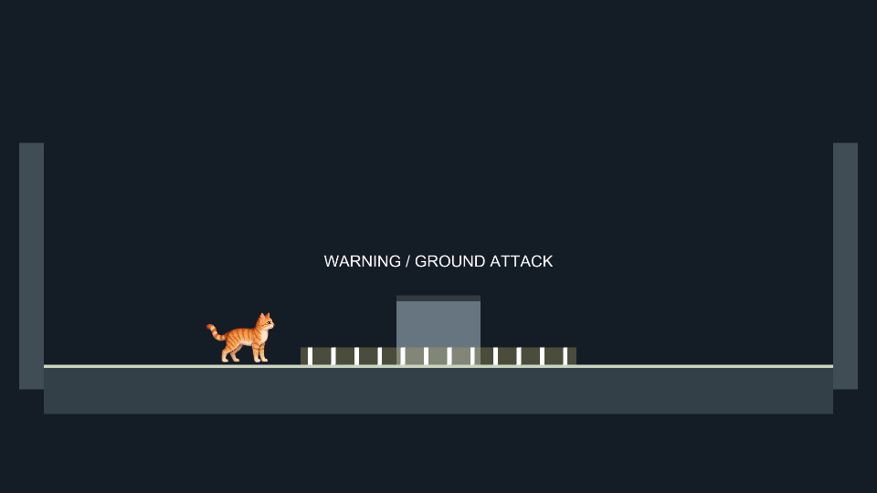
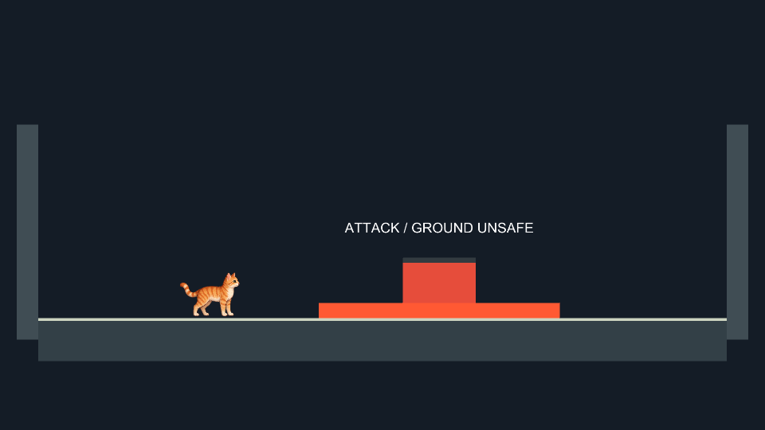
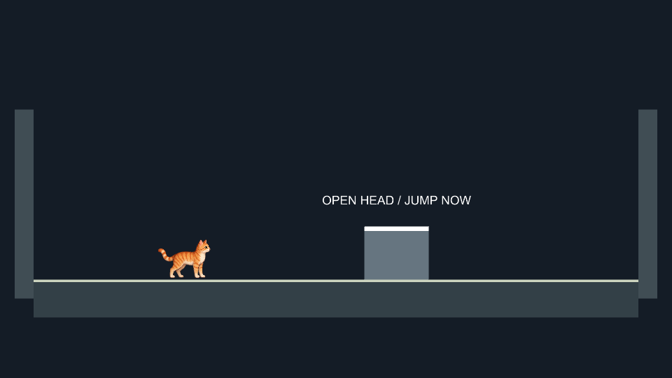
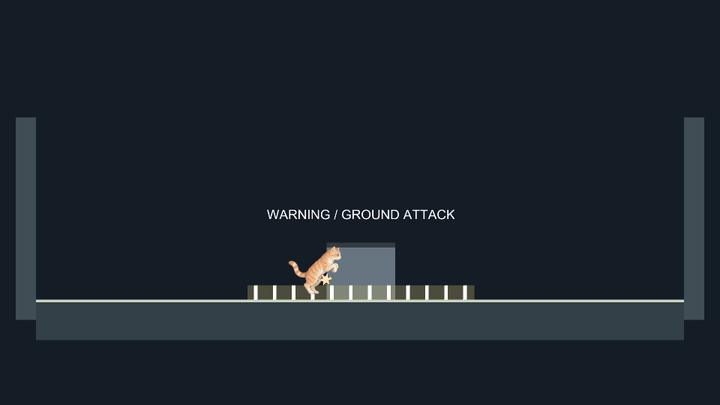
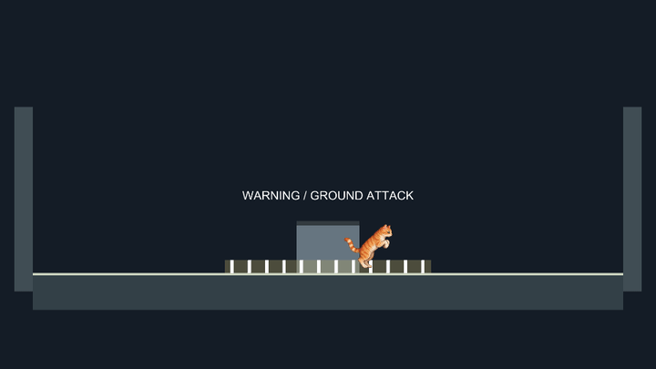
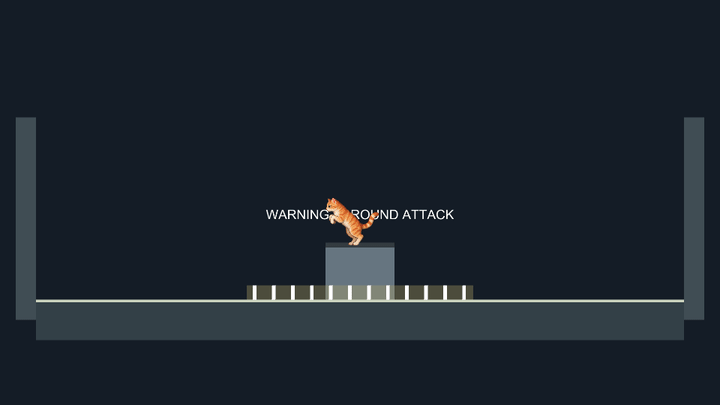
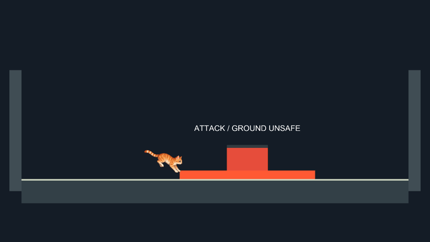
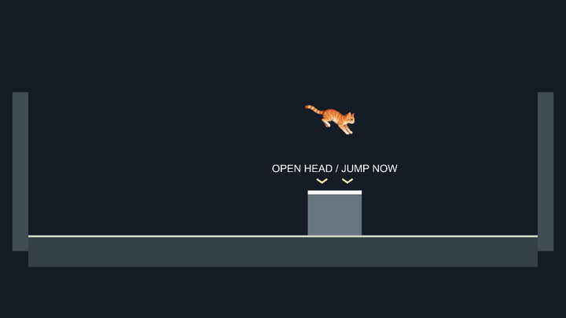

# Stomp encounter prototype

Issue #12. Open **Stomp lab (prototype)** from the main menu. This isolated runtime arena reuses CatController, CatMotion, CatInput and MikaOriginal; it does not alter the movement course, campaign, saves or character artwork.

## Provisional rules for user review

A target moving horizontally throughout every attack phase previews a ground attack for 1.2 seconds (striped ground band), attacks for 0.35 seconds (solid band), then exposes its white head for 1.8 seconds. Labels and silhouettes distinguish the phases without depending on hue. The band's bounds exactly match the ground hazard. The target body remains dangerous from the side; descending feet must cross the head's top during recovery. A hit immediately closes the opening, removes one of three target health points and bounces Mika at 10 units/second. No stomp button is added.

Mika has three provisional health points. Damage gives 1.25 seconds of protection and applies recoil at the current position; it never teleports Mika. The initial velocity is 5 units/second away from the target and 7 upward. The horizontal impulse decays at 25 units/second squared (0.2 seconds), separately from normal movement braking; steering remains active. At centered contact, the previous side decides direction, then opposite horizontal motion, with left as the final fallback. Protected contacts neither damage nor launch again. Ground attacks can be jumped over. Jump release does not cut the automatic bounce; ordinary jumps retain their existing release behavior. Swept body/feet checks cover crossings between physics samples. Presentation uses the same state that resolves each fixed-step collision; visual effects do not delay simulation.

Retry (R / controller Select) and full restart (Backspace / controller LB) reset the entire encounter through RunLifecycle.ResetTransientState, including health, attack phase, protection, impact, momentum and input buffers. Pause (P / controller RB) freezes physics, combat timers and the protection pulse. During protection Mika smoothly pulses between original and half opacity every 0.25 seconds; she never disappears. Retry, restart and encounter completion restore her original color. Both win and loss retain Retry and Menu; no automatic retry cost is imposed. Menu is Esc / controller Start. Move/jump use the existing shared actions, including controller bindings. Touch UI is outside scope.

The target follows a smooth horizontal patrol, x = 2 sin(0.6 t): a two-unit radius and maximum speed of 1.2 units/second. It keeps moving with its head open, reverses smoothly, freezes on pause or encounter completion and resets on retry. A successful stomp does not reset patrol position. Collision sweeps subtract both previous and current target position, so a moving head can pass under descending feet. Warning stripes, active ground hazard and labels track the same target position.

The component supports its default unit scale and translation. Rotation or scaled arena instances are not supported tuning contracts. There is no production boss identity, final difficulty or additional traversal ability.

## Review gate and remaining work

**User review pending.** Compare telegraph clarity, head window length, bounce height, damage feedback and retry cost in the playable arena before selecting final prototype attack rules/difficulty. These numbers are proposals. Keep the PR draft and #12 open until that review and final validation are complete.

The three images below are actual Unity Play Mode camera renders of the runtime arena. The capture advances combat state explicitly to show the same presentation used by gameplay; it is not a manual playtest or evidence of collision behavior. The camera render excludes the GUI overlay. Run `StompReview.Record` in the pinned Editor to reproduce them. Code includes behavioral regression tests for hit direction, closed windows, damage protection, defeat, bounce and lifecycle reset; they have not yet been executed. Final exact-head Prepare merge must run tests and Windows/Linux player and launcher builds after review.

## Coordination and validation

Started from main 989840a. No overlap with open PR #51 (Blender sources), #53 (reward design) or #59 (CI workflows). Ownership: new StompCombat/StompArena/review/tests and narrow CatMotion/CatController launch and StarterScreen menu integration. Existing scenes, prefabs, packages, project settings and art remain owned by their existing features. No new serialized scene is required. Main's current movement/input/presentation integration is reused.

Unity 6000.3.27f2 import, script compilation and Play Mode phase capture completed with exit code 0 on 2026-10-31. New .meta files were generated by Editor import; packages-lock.json was unchanged. Git whitespace inspection passed. Automated tests, platform builds, in-motion/manual gameplay, small-window/grayscale play review and exact-head merge validation remain pending. No release or merge is authorized.

## Damage feedback revision - 2026-10-31

The user rejected the instantaneous left/right repositioning and selected recoil with a gently transparent protection pulse. This decision changes damage feedback only; attack difficulty remains under review.

`StompReview.Record` also captures four scripted Play Mode physics sequences: left/right body contact, closed head and active ground attack. Each starts at a known contact and then advances the actual motor, local 2D physics scene and arena in fixed steps, using no input-device polling. Camera rendering excludes the GUI. GIFs play at the recorded rate; their loop boundary restarts the demonstration and is not an in-game teleport. CSVs record position, health, protection and opacity. These reproducible scripted captures do not replace manual playtesting or the pending automated test suite.

Unity 6000.3.27f2 compiled the updated runtime and test sources and completed all four motion captures with exit code 0. The left/right traces start at x=-1.1/+1.1 without repositioning on damage; their following positions change through simulated recoil. Further hits can occur after protection expires if Mika remains in an active hazard.

Regression sources additionally cover no position change on damage, protected contacts without repeated impulses, the 1.25-second boundary, the opacity trough, pause/reset and recoil with active steering. Full automated tests/builds remain deferred until final Prepare merge.

## Moving-head and hit-feedback review - 2026-10-31

The user selected jumping onto a moving head, approved a brief hit flash and a discreet damage tone, and excluded heart-loss animation/new health UI from #12. Existing text counters remain prototype information.

Real damage triggers an 80 ms fading white flash over Mika's authored sprite, followed by the existing protection pulse. The flash preserves source alpha and does not illuminate the whole screen. A quiet original 120 ms falling sine tone plays once per accepted damage event; protected contacts do not retrigger either effect. Pause freezes flash/movement and pauses the tone; retry stops playback and clears feedback. The shader is loaded from Resources so player builds retain it. The runtime creates a nonspatial AudioSource and supplies an AudioListener only if the scene has none.

[Damage sound preview](damage-tone.wav) exports the runtime-generated samples at the same 0.12 source volume, not a recording of audio-device output. `damage-moving-head.csv` records target position and boss health alongside player state. The motion sequence starts above an already open head to isolate landing, moving hit detection and bounce; it is a scripted physics demonstration, not an input playtest. Existing damage captures now also show the moving target and hit flash.

Regression sources cover motion through recovery, bounded continuous patrol, no patrol reset on a successful hit, relative-motion head crossing, pause/reset, and the original tone's duration/envelope. Compile and rendering are performed in an isolated review copy while the user's Editor owns the main worktree; the copies never share a Library. Automated tests and Windows/Linux builds remain deferred to final Prepare merge; manual audiovisual/gameplay acceptance remains pending.

The isolated Unity 6000.3.27f2 Play Mode capture and final runtime/test-source compilation both completed with exit code 0. The moving-head sequence records a successful head hit at frame 16 (approximately 0.32 seconds), boss health 3 to 2, player health still 3, and an upward bounce in the next physics sample. Target X continues increasing through the hit. The captured white flash was inspected against the unchanged source silhouette; no shader compile errors were reported. The sound preview exports the generated waveform; audible in-game listening remains part of user review.
