# Stomp encounter prototype

Issue #12. Enter **Simple combat lab** from the main menu. The main menu lists Movement lab first and Simple combat lab second. The isolated greybox reuses CatController, CatMotion, CatInput, RunLifecycle and MikaOriginal. It adds no campaign, save format, new health UI or traversal ability.

## Current validation status

The first full Prepare merge run on `b6e1272` passed 203/204 Unity tests; the Linux
headless audio test failed at its initial `isPlaying` assertion after a fixed
120 ms wall-clock wait. Both Windows/Linux player and launcher builds, packaging,
smoke checks and Delta checks passed in that run. The audio test now uses Unity's
offline mixer and verifies actual nonzero samples, playback position, protected
contact, pause/resume and reset without a physical audio clock. The new revision
must pass automatic exact-head validation before merge readiness can be claimed.
See [the failed run](https://github.com/LeonHorner/LegendOfCat/actions/runs/41306648831).
Local verification of the final offline-audio correction: **204/204 EditMode tests
passed**, no failures/skips, exit 0, in isolated Windows Unity 6000.3.27f2. The
archive fixture was copied into that isolated project before the successful full
run. [Unity AudioRenderer](https://docs.unity3d.com/6000.3/Documentation/ScriptReference/AudioRenderer.html)
renders the real mixer on the main thread; the test sets/restores capture rate and
stops recording in finally. No skip, mock audio source, gameplay change or silent
fallback is used. This includes the existing protected-contact and lifecycle tests.
Current main `981bf1b` (#69, semantic-release restoration) was already integrated
by PR commit `b6e1272`; this worktree fast-forwarded to that existing PR revision.

Historical pre-CI results:

The latest integrated review passed **111/111 focused Unity tests**, including the
unchanged 34 combat cases, movement, menu transitions, lifecycle, scenery and release
history. The earlier `edb3ad1` result was **34/34 focused combat tests**. The dated
main-integration pass below records additional contract checks and remaining limits.
Earlier capture-only results are dated historical evidence, not the current test
status. Full exact-revision Prepare merge validation, Windows/Linux player and
launcher builds, packaging/smoke checks and final user gameplay/audio acceptance
remain pending for those historical revisions. PR #62 was subsequently made ready
for review externally; this fix preserves that state and does not authorize merge
or release. Issue #12 remains open.

## Current encounter

- Warning: 1.2 seconds, striped ground band and closed dark head.
- Attack: 0.35 seconds, solid ground band and closed head.
- Recovery: 1.8 seconds, white vulnerable head. Descending feet must cross its top; side/body contact still hurts.
- The target moves in every phase, including recovery: x = 2 sin(0.6 t), radius 2 and maximum speed 1.2 units/second. Warnings, ground hazard and labels follow its actual position. Sweeps use relative player/target movement.
- A valid stomp removes one of three target health points, bounces Mika upward at 10 units/second and restarts the attack cycle without resetting patrol position.

The timing, patrol and health values remain prototype tuning for user review. A later production boss, phases, art and complex attack patterns belong to #18.

## Damage feedback selected for this revision

Damage preserves horizontal velocity and applies only an upward velocity of 7 units/second. Held movement remains active; no forced direction change, horizontal stop, lateral impulse or teleport occurs. Releasing jump does not shorten the automatic hop. Side contact, closed-head contact and the active ground band can cause damage.

A small original irregular cream contact burst with a feathered warm rim and three tapered brush strokes opens and fades over 0.15 seconds. It appears on the contacted boss/hazard surface at the collision sample, stays at that arena-space point instead of following either character, and has no collider. High-speed crossings use the swept contact; existing overlaps use the nearest surface point. The burst uses native mesh geometry with a vertex-alpha feathered rim and contains no imported image. Its brief opening changes width/height separately and rotates slightly; the smaller strokes travel out and taper away. A reduced 35%-strength white flash fades over 80 ms so it does not compete with the star. No camera shake or hitstop is added.

Damage gives 1.25 seconds of protection. Mika gently pulses between original and half opacity every 0.25 seconds and never disappears. Protected contact causes no extra damage, hop or effect restart. Pause freezes physics, combat and effects. Retry/restart clear all transient feedback and restore the original sprite color. Effects finish fading after a terminal hit; win/loss retain Retry and Menu.

The previous lateral recoil and falling sine tone were rejected by the user. They are removed from active gameplay. Accepted damage now plays the selected 0.9-second real-cat vocal once, at AudioSource volume 0.5. Protected contacts do not retrigger it. Pause/resume pauses/resumes playback; retry, restart and leaving the arena stop it. The old `damage-tone.wav` is retained solely as a rejected historical preview.

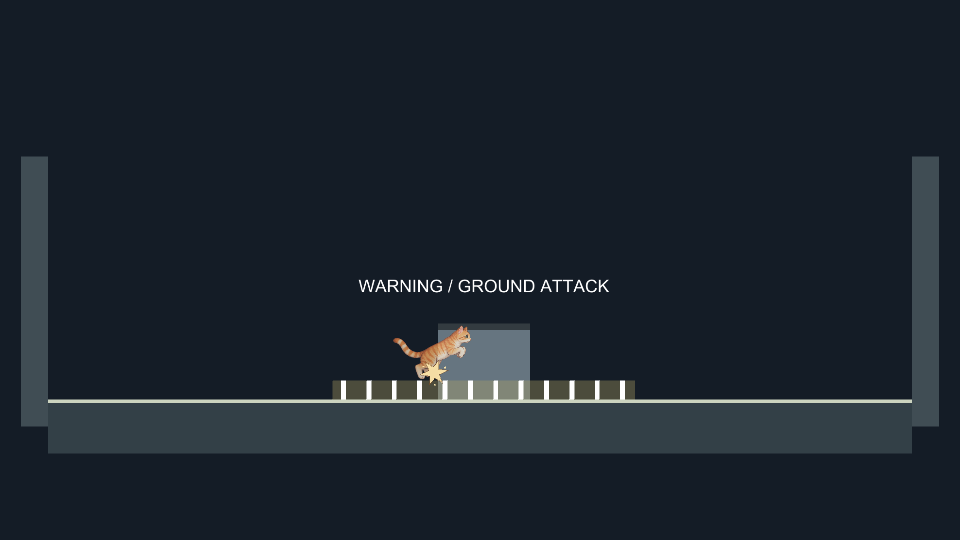
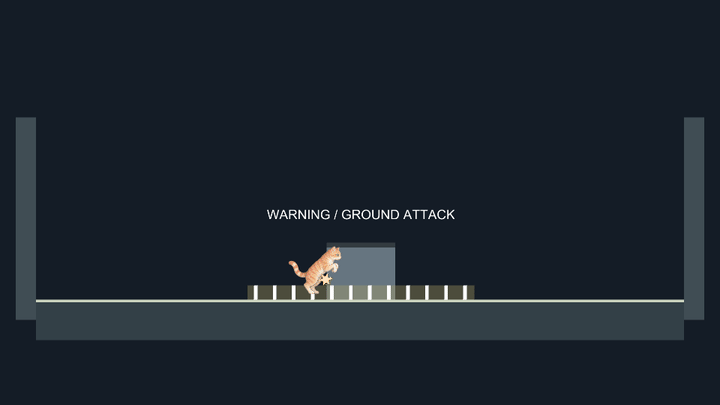
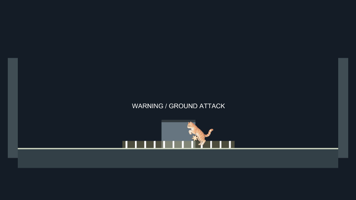

## Selected real-cat damage voice

The user rejected the abstract proposals, the attention-seeking cat-meow reference and the 420 ms performed human-voice candidate (too short and insufficiently cat-like). The current direction is a real-cat vocalization with a rough abrupt beginning and a recognizable longer ending.

The user selected the second version (0.9 seconds) on 2026-10-31. Review excerpts of **Cat Angry Meow.WAV** by **softcoresoft**, [Freesound](https://freesound.org/people/softcoresoft/sounds/327438/), [CC BY 4.0](https://creativecommons.org/licenses/by/4.0/):

- [Natural-speed excerpt, 1.2 seconds](sound-options/real-cat/natural-reaction.wav).
- [Shorter excerpt, 0.9 seconds](sound-options/real-cat/short-reaction.wav): same phrase accelerated with pitch preserved, rather than an earlier cut.

[Attribution, license, modifications and source hashes](sound-options/real-cat/README.md) accompany the retained public source preview. The 0.9-second version is copied unchanged to `Assets/Game/Resources/StompDamageVoice.wav` and loaded through Resources. Import settings preload uncompressed PCM to avoid a first-hit decode/load delay. The source describes actual hissing/meowing; the user selected its damage-feedback fit. The prior performed-voice clip remains in sound-options/cat-reaction solely as rejected history.

## Rejected abstract sound proposals

These three rejected original unpitched noise-based proposals have comparable RMS level and quiet peak limits. They contain no external recordings, cat vocalizations, melody or pitch glide. Reproduce them with `python tools/generate-stomp-sound-previews.py`; the deterministic generator documents synthesis and envelope choices. None is wired into gameplay. They remain solely as rejected review history.

1. [Soft impact](sound-options/soft-impact.wav): low, softly damped impact, 120 ms.
2. [Muted tap](sound-options/muted-tap.wav): shorter, slightly clearer tap, 85 ms.
3. [Soft rustle](sound-options/soft-rustle.wav): airy fabric-like contact, 140 ms.

## Refined combat signals

Warning uses diagonal hatching, a low footprint edge and increasingly close pulses. The closed head has two small cross marks in addition to its dark cap. The active ground attack replaces hatching with a solid band and short upright strike marks; every strike mark stays inside the actual 0..0.35-high hazard. Recovery removes the ground warning and replaces head crosses with two downward chevrons over the existing white contact edge. Marks track the moving target; their visibility changes directly with combat phase, including the exact open/closed transition. Pause freezes their animation because it uses combat time. No health UI or collision geometry was added.

Successful head hits use a distinct flat expanding ring at the head contact and a separate brief edge flash on the moving head. They do not start Mikas damage burst, flash or cat voice. Damage keeps its separate warm burst, selected cat voice and protection feedback.

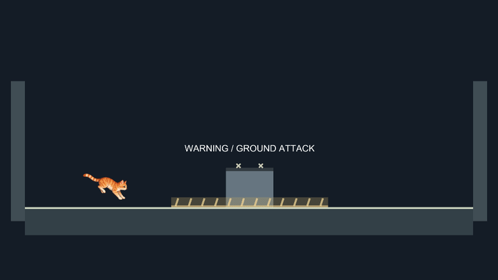
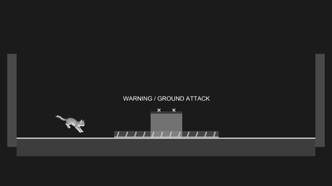

**Historical signal capture, 2026-10-31.** The signals and contact burst were captured in Unity 6000.3.27f2 Play Mode with exit code 0. The first isolated startup failed before logging; a retry with fewer worker threads and Direct3D 11 completed without C# exceptions or shader errors. Both user-owned Editors stayed open. Color frames and the 480-pixel-wide grayscale recovery view were inspected: crosses, upright attack marks and downward chevrons distinguish states without relying on hue. The small grayscale GIF is a downscaled camera capture, not a live small-window/input playtest. Existing movement/health/protection CSV traces remained unchanged; a new signals trace records the complete cycle. Regression sources additionally check phase-specific marker visibility and active marks staying inside hazard height; the suite had not yet been run at that capture; the subsequent focused run passed 34/34 tests.

## Controls and reuse

Move/jump use the existing shared keyboard/controller actions, without a stomp button or device polling in combat. Retry: R / controller Select. Full restart: Backspace / controller LB. Pause: P / controller RB. Menu: Esc / controller Start. Retry and restart restore target health, patrol and phase, player health, movement/input state, protection and effects via RunLifecycle.ResetTransientState. Touch UI/mobile builds are outside this issue. Default unit scale and translation are supported; rotation/scaled placement is not a tuning contract.

## Historical capture evidence - 2026-10-31

Run `StompReview.Record` in Unity 6000.3.27f2 to reproduce camera captures and CSVs. Phase screenshots explicitly advance state; twelve motion sequences advance the real motor, isolated local 2D physics scene and combat. The running sequences feed shared motion values and preserve held direction through contact. CSVs record player/target position, health, protection, opacity, velocity and effect lifetime/contact position. The moving-head sequence starts above an open target to isolate hit detection and bounce. Camera captures exclude the GUI; GIF loops restart the demonstration and are not in-game teleports.

Compilation of runtime and regression sources plus the Play Mode captures completed with exit code 0 in an isolated review project with its own Library. The right-running trace starts at x=-1.1 with velocity (7,7) on damage, then x=-0.96 with velocity (7,6.4); left-running mirrors this without a direction reversal. The star remains at x=-0.85/+0.85 while its timer decreases. Captured contact-star rendering was visually inspected. The sound previews were checked for PCM format, duration, RMS and peak levels; subjective listening remains a user decision.

Regression sources cover top/side/closed windows, moving-head sweeps, protection expiry, preserved horizontal velocity, held run direction, hop release behavior, effect placement without retrigger, pause and retry cleanup. At this capture, automated tests and platform builds had not been run. Subsequent review ran the focused combat suite and live small-window/grayscale checks; see the current validation status and dated results below. Full Prepare merge and final user gameplay/audio acceptance remain pending. Keep PR #62 draft and #12 open until review and final exact-head validation complete.

## Coordination and review history

Historical starting point: main 989840a. Ownership covers new combat/arena/review/test code and narrow controller launch/menu entry integration. No overlap was identified with #51 (Blender authoring), #53 (reward design) or #59 (CI). The initial feature preserved existing scenes, prefabs, packages, project settings, movement course and character artwork. No shared mutable Library is used for review captures. The authorized normal main integration is recorded below; no feature merge or release is authorized here.

User decisions on 2026-10-31: reject damage teleport; select short protection with transparency pulse; select a moving vulnerable head; exclude new heart-loss/health UI; reject the first tone and lateral recoil; preserve running with an upward-only damage hop; request sound alternatives and approve a small contact star with restrained flash; select the compact real-cat voice; request a softer contact effect and clearer combat signals. Earlier implementation screenshots/commits are historical, not acceptance of superseded feedback. Provenance is in ASSETS.md.

### Selected-audio integration

The selected clip is nonspatial and non-looping, plays only inside the accepted-damage branch, and shares encounter pause/reset cleanup. An AudioListener is created only if the scene has none. `Assets/StreamingAssets/THIRD-PARTY-NOTICES.txt` accompanies player builds with the creator, source, CC BY 4.0 link and edit disclosure. Regression sources verify the selected 0.9-second resource and source configuration alongside existing protected-contact/reset behavior. At this 2026-10-31 audio-integration capture, tests had only been compiled; the later focused run verifies actual playback. Full validation and both platform builds remain pending. In-game listening with the chosen playback volume remains part of user playtesting.

## Separate player and enemy damage feedback

Mika damage retains the irregular warm burst, brush strokes, restrained sprite flash, vertical damage hop, selected cat voice and protection pulse. An accepted enemy head hit instead emits a hollow pale ring: width grows from 0.3 to 1.1 units over 0.18 seconds while fading, with a flat 0.10-to-0.24-unit height. The ring has its own native mesh and stays at the swept landing contact point. A separate 0.08-second narrow head-edge overlay follows target position and leaves the newly closed dark cap and crosses visible. Its brightness is cosmetic and does not reopen vulnerability. No enemy-hit cat voice or damage sparks are started.

Effects start only after accepted damage. Pause freezes both sets; retry/restart clear their timers and visibility. Terminal effects keep fading after combat stops. Existing movement, health, damage windows, protection and retry rules are unchanged. The current lab name is Simple combat lab; Movement lab precedes it in the main menu.

### Historical distinct-hit capture verification - 2026-10-31

The full capture now includes player-hit/enemy-hit and terminal player/enemy cases. `StompReview.Record -stompReviewHitsOnly` refreshes those focused cases and moving-head landing. The capture synchronizes deliberately placed fixture transforms before the first physics step. This corrects review setup synchronization without changing runtime movement.

Unity 6000.3.27f2 compiled current runtime and regression sources, including the menu rename/order, and completed the focused captures with exit code 0. The enemy-hit trace starts with boss health 2, player health 3, ring time 0.18, edge-flash time 0.08, player-burst time 0 and audioPlaying false. The player-hit trace instead records boss health 3, player health 2, player-burst time 0.15, enemy timers 0 and audioPlaying true. The ring X stays fixed while the head-edge X follows patrol. Both terminal traces end with all visual-effect timers at zero. Audio playback flags use real DSP time; fixed-step capture time is not a wall-clock audio-duration test.

Below: **left Mika takes damage; right the enemy takes damage**. Both comparisons use equivalent crops of actual runtime camera frames and play at **half speed** to show the brief shapes. The grayscale comparison is additionally scaled to 320x180 per panel, not a live small-window input test. The hollow ring, solid irregular player burst and actor reactions remain distinguishable without hue. Original full-frame recordings retain normal timing.

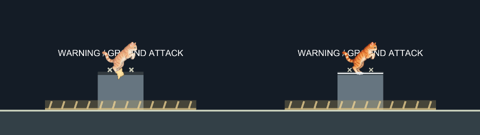
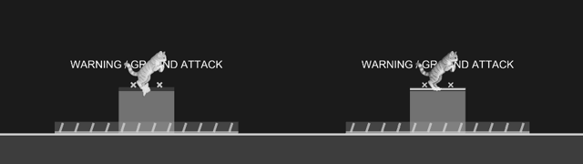

Regression sources cover separate triggers, no enemy effects on player damage, no player burst on enemy damage, protected contacts without effect restart, pause/reset, fixed ring position and terminal fade. At this 2026-10-31 capture they had been compiled but not executed. The 2026-11-01 focused run subsequently passed 34/34; final Prepare merge must still validate all tests and both platform builds. No ready status, merge or release is claimed by this review pass.

## PR review corrections - 2026-11-01

The stomp ring now uses the original descending sweep before bounce height correction.
Its center is clamped to the head interval interpolated at the contact instant, so
partial foot overlaps and fast horizontal travel cannot put its origin beyond the
contacted head. The ring stays at that world contact while the head moves away.
The visible cap and separate flash now end at the unchanged logical surface,
y=1.35. Bounce retains the existing y=1.82 clearance correction, x position and
horizontal velocity; no damage-hop, protection, input, patrol or phase tuning changes.

The arena uses MenuLayout.Letterbox16By9 and an explicit 16:9 camera aspect, retaining
the existing world coordinates and framing. Solid-color clearing avoids inheriting
an unrelated scene skybox. The normal HUD is compact; Controls expands wrapped
instructions and reset actions. Pause/results also expand it. Available width and
height bound the panel, with scrolling when necessary. A tall window uses its upper
letterbox space for the panel. This is prototype UI, not new health presentation.

Behavioral regressions add actual scripted 2D simulation for centered and partial
edge landings, both horizontal directions, a 35-unit/s sweep and outside-head misses
against a moving target. They assert contact location, unchanged x/velocity, bounce,
health, phase and visible edge registration. Existing behavioral tests are retained;
terminal cases cover both Retry and Restart. A Play Mode coroutine verifies actual
audio playback, sample progress, pause/resume and no replay during protected contact.

Reproduce live small-window evidence with StompReview.OpenInteractive in the isolated
artifacts/stomp-review-project copy. It opens a real free-aspect Game View, resizes
through 640x360, 480x640 and 320x240 requested content sizes and captures the GUI plus
a complete live patrol/signal cycle at each size. Editor toolbar rounding can add
one pixel to the requested height. Captures run in wall-clock time rather than the
deterministic physics-only recording loop. Grayscale exports are derived from these
actual window frames, not from a wide-view crop.

Integration review: origin/main f020aea adds #59 workflow/licensing modernization,
#64 splash-screen settings, #66 release-history cleanup and #63 retirement of the
standalone background study in favor of SceneryRenderer. No stomp arena overlap was
found. Open PR #61 owns water-recovery integration in the shared controller; this
review pass changes no controller/motor files. Preserve both features and provenance
when integrating. Per the requested gate, the later integration pass below supersedes the deferred main merge; full
exact-revision validation still follows final gameplay approval. Keep #62 draft and #12 open.

### Focused review validation - edb3ad1

Unity 6000.3.27f2: **34/34 focused StompCombatTests passed**, zero failures/skips,
exit code 0. This includes real audio playback in Play Mode and all new physics
cases. The first two runs exposed scene-setup restrictions in the new EditMode
fixture; it now uses the project's existing scripted-physics test pattern and
restores simulation mode in cleanup. Source SHA256 hashes and the result summary
are retained in [review-validation.json](review-validation.json). This supersedes
earlier statements that the combat suite had only been compiled. Full suites,
Windows/Linux player/launcher builds and packaging/smoke checks remain unrun here.

Actual free-aspect Game View captures measured 640x361, 480x641 and 320x241 pixels.
Mika's spawn, the moving target, the complete warning/attack footprint and compact
HUD remain visible. At 320x241 the phase text is very small; the cap, crosses,
chevrons and ground marks carry the gameplay distinction. Grayscale frames retain
those different forms. Expanded controls intentionally cover gameplay when paused
or inspecting instructions; Retry/Restart remain reachable in the smallest window.
Live mouse checks verified defeat Retry restored both health counters and the
compact HUD, and Pause exposed Resume with wrapped controls inside the window.
This establishes layout behavior, not final difficulty or user gameplay acceptance.

Recordings sample 40 actual window frames at approximately 10 Hz; GIFs encode at
10 fps and loop. Capture scheduling/frame load can cause small timing differences;
use the deterministic CSV captures for precise physics timing. Unity's unrelated
Search database startup callback raised an Editor exception during interactive
startup; the deferred update-based window setup completed despite it. No runtime
combat exception or C# compilation failure was observed. Backups from the isolated
review scene were preserved locally, outside tracked assets.

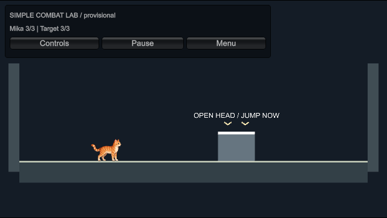
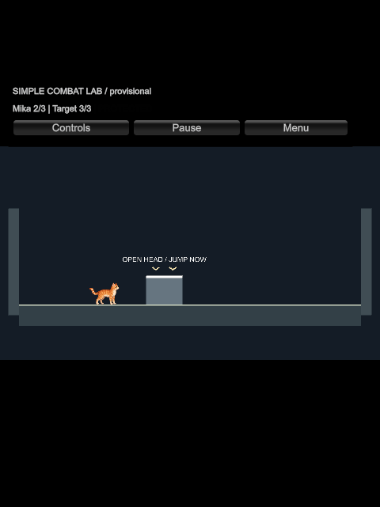
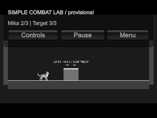
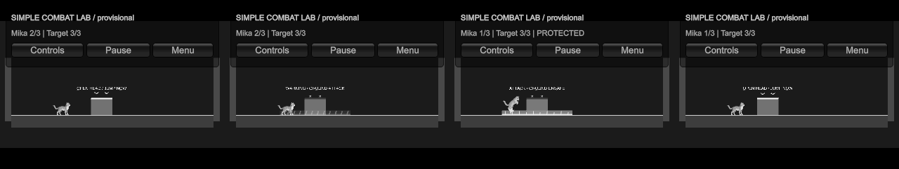

## Final-review improvements and main integration - 2026-11-01

Pause is hidden after victory or defeat; Retry, Restart and Menu remain accessible.
TogglePause and the combat lifecycle are unchanged. The existing HUD title now
includes a short phase/result hint (WARNING, GROUND ATTACK, OPEN HEAD, TARGET
DEFEATED or TRY AGAIN) using the existing 11-pixel UI font. This makes the state
readable at 320x241 without enlarging the HUD or obscuring the attack geometry.
The world label and all geometric phase indicators are retained.

Normal merge `d417d21` integrates main
`afc740af782811ab43216c76bd9b98b86cc4a0d7`; there were **no conflicts**.
The five commits since divergence are #59's reviewed action/account-activation
updates and build success marker, #63's SceneryRenderer/BuildScenery restructuring
and standalone-study retirement, #64's disabled Unity splash, #66's release-history
cleanup, and #68's case-sensitive breaking footers, frozen release snapshots,
release permission gates and draft recovery. The imported workflow/build/config,
scenery and release-history files match main exactly. No unrelated change was
reverted; source artwork, audio, licenses and metadata are preserved.

PR #61 was inspected at `affe551d307099956d017529e1552a0f10dc32a2`.
It owns Recovering/SetRecovering, water-entry interception and recovery-aware pause
and respawn. This pass leaves CatController and CatMotion identical to `edb3ad1`:
Launch and the automatic rise/held movement behavior remain intact. The stomp lab
does not attach WaterRecovery; there is no simultaneous water/stomp lifecycle today.
When #61 integrates the shared controller, preserve Launch, external-rise handling
and EditMode-safe material cleanup alongside its recovery lock; do not allow a launch
to bypass an active recovery lock. #61 also needs its course/scenery references
reconciled with #63's rename. No water implementation was copied or merged here.
Combined runtime compatibility remains an integration check owned by #61, not a
claim established by inspecting separate branches.

### Executed integration checks

Unity 6000.3.27f2 in a new isolated project with its own Library:
**111 passed, 0 failed, 0 skipped**, exit 0. Selected classes: StompCombatTests,
MenuMovementIntegrationTests, CatCollisionTests, CatMovementTests, RunLifecycleTests,
DesktopBehaviorTests and SceneryRendererTests. A new behavioral menu round trip
checks exclusive lab ownership, immediate input/audio shutdown on Menu, reopening
fresh combat state, and the movement lab using SceneryRenderer. Existing movement
and resource-cleanup cases passed after main's rename.

The machine-readable [integration-validation.json](integration-validation.json)
records the main/merge SHAs, per-class counts and hashes of the tested working-copy
sources. [review-validation.json](review-validation.json) remains the historical
34-case result rather than being overwritten with a different test scope.

The unchanged audio coroutine passed with actual playback/sample progression,
protected-contact suppression and pause/resume in batch-mode Windows Unity.
No concrete reliability failure was found, so no weakened assertions, skips or
replacement audio test infrastructure were introduced. Linux Unity's audio backend
and the complete exact-revision CI suite remain part of final Prepare merge.

Refreshed actual Game View recordings include HUD and motion at 640x361, 480x641 and
320x241; the grayscale small view now has a legible phase hint while retaining the
same visible arena width and attack shapes. Live inspection confirmed Pause absent
after defeat, both reset buttons and Menu visible, and Restart restoring 3/3 health
and the normal Pause button. Victory shares the same finished-state rendering path;
terminal victory/reset behavior also remains covered by combat tests. Sampling and
Editor-only startup warning limitations from the preceding window review still apply.

### Local workflow and release-contract checks

With locked dependencies installed using `npm ci --ignore-scripts`, the portable
Windows subset (workflow, approval, analyzer, snapshot and release-assets tests)
passed **36 tests, 0 failures, 1 intentional Linux-only skip**. The broader Windows
attempt included release-recovery tests: 40 passed, 10 failed and 1 skipped because
the POSIX executable `gh` fixture is not selected by native Windows. The attempted
API reads used the fixture's mock token and failed with HTTP 401 before mutation.
Those imported files match main; no unrelated release-tool rewrite was added.

The same broader suite passed **51/51 tests, 0 failures/skips**, exit 0, under local
WSL Linux using portable Node 24.19.0 with the official archive SHA256 checked.
Files: ci-workflow, release-approval, release-analyzer, release-snapshot,
release-recovery and release-assets test suites. This checks the intended
POSIX fixtures locally, not a GitHub workflow or a player/launcher build. Final
exact-revision Prepare merge, platform packaging/smoke validation and user
gameplay/audio acceptance remain outstanding. No merge-ready status is claimed.

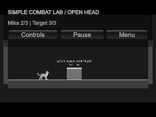
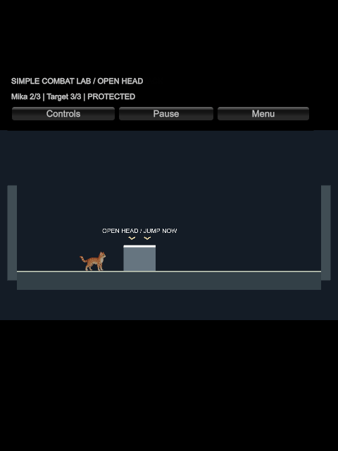
