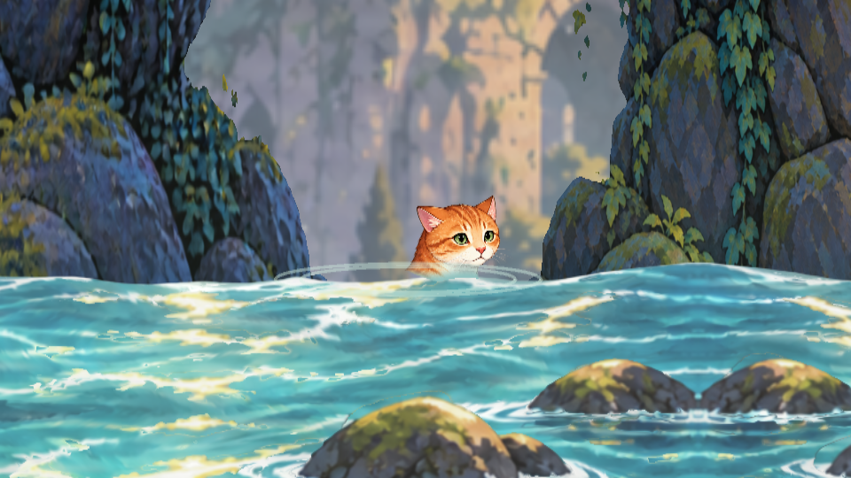
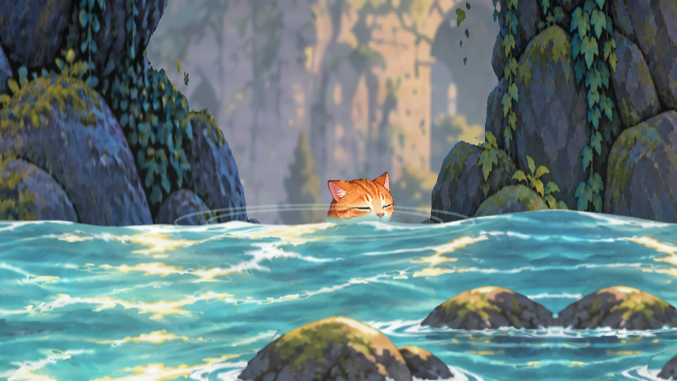

# Mika water recovery — approved storyboard revision

Issue #60. The user authorized an integrated first version on 2026-10-31 after
requesting a splash, sinking face close-up, short blackout and checkpoint return.
The user liked the first version's zoom and fade, rejected its floating-body
animation, and approved the six-panel storyboard for implementation. The current
revision follows that storyboard; final in-game acceptance and merge validation
remain open.

[Normal-speed Unity preview](recovery.mp4) · [Half-speed preview](recovery-slow.mp4)

## Playback

Open the normal main scene in Unity 6000.3.27f2, restart Play Mode after importing
this branch, enter the movement lab and walk off a platform into the river.
Mika continues through the initial splash using her existing falling drawing.
The splash overlaps the transition to a submerged neck and eight connected
head-turn drawings. Her gaze turns toward the camera, she blinks, then the
water covers her face and ears. The camera zoom and fade retain their first-version
parameters.
The screen fades to black and returns to the last activated checkpoint, or the
course start before any checkpoint. The sequence takes 2.5 seconds.

For quicker repetition, while playing the movement course select
`LegendOfCat > Water recovery > Preview first gap`. It places Mika over the first
gap; normal falling triggers entry. Outside Play Mode the command opens an unsaved
course preview after offering to save the current scene, then enters Play; invoke
it again to drop Mika. R retries immediately; Backspace restarts the whole run;
P pauses; Escape returns to the menu. Pause freezes the recovery clock. Movement
and jump cannot interrupt submersion. Manual retry clears all recovery effects.
The independent background-study lab uses its existing return-to-start behavior.

## Implementation and limits

`WaterRecovery` intercepts descending collider contact at course-local y=-3.25,
registered with the foreground water. It suspends body simulation and continues
the original impact drawing downward for
0.14 seconds, then presents connected head-and-neck drawings through a world-space
waterline clip. A breaking shoulder splash clears within 0.4 seconds; droplets and
ripples follow. The head keeps descending during the turn and blink. The sequence
calls the course's existing retry callback once under black. `CatCamera`
yields during the close-up; scenery follows that camera before rendering.
No persistent format, checkpoint policy or movement ability is added.

The surface is a level plane matching the prototype river, not per-pixel buoyancy
or freely swimmable water. The waterline mask has a small wave. The head turn and
transition from the
existing airborne art remain subject to in-game motion review. The approved
[storyboard](storyboard/approved-storyboard.png) sets the staging; it is not a
screenshot of the implemented effect. [Source generation and exact prompt](storyboard/generation.md)
record the new atlas. One common pixel scale preserves the skull size; a bottom-row
pivot offset corrects its authored registration without runtime deformation.
There is no new sound. Generated expressions are prototype artwork, not
acceptance of a replacement locomotion set. Current running/airborne drawings are
retained outside recovery. Close framing may expose scenery reuse more clearly.

`WaterRecoveryPreview.Prepare` reproducibly imports the source without power-of-two
distortion, mipmaps or texture compression. `WaterRecoveryPreview.Capture` renders
76 deterministic frames at 30 fps under ignored `Logs/water-review`. Camera.Render
does not invoke IMGUI, so this authoring capture applies the same fade numerically.
These are Unity-rendered presentation captures, not a recording of player input.

## Coordination

Ownership: water entry/recovery, the controller's recovery lock, camera handoff,
course/study attachment, the new reaction sheet, authoring tool and scoped tests.
Open PRs #51 (Blender character authoring), #53 (keepsake decision docs) and #59
(CI/licensing) have no overlapping files. New PR #62 (stomp combat) shares
CatController with the original water feature. This storyboard revision only edits
WaterRecovery, the authoring tool/tests and water assets/documentation; it leaves
CatController and CatMotion untouched. This water PR owns recovery-lock integration
when the shared controller is reconciled before readiness. Preserve both independent
ASSETS.md provenance sections during integration. Issue #60 has no native blocked-by
relationships at inspection. Existing local Linux toolchain package edits are
unrelated and excluded from this branch's commits. No serialized scene/prefab
editing is needed; runtime course construction attaches the behavior.

## Validation

- Unity 6000.3.27f2 imported and compiled the first version.
- Initial-version focused EditMode tests passed in an isolated project with its own Library:
  descending entry and single checkpoint retry after blackout, pause/manual retry
  cleanup, and rejection of upward entry. A translated/scaled course is exercised.
- The initial-version scoped regression run passed 14/14 tests across WaterRecoveryTests,
  CatCollisionTests and RunLifecycleTests, with zero failures or skipped tests.
- The revised scoped regression run passed 16/16 tests across the same fixtures,
  with zero failures/skips, using an isolated project with its own Library.
- Revised Unity-rendered review frames were inspected for impact continuity,
  neck immersion, three-quarter gaze and visible blink before the ears disappear.
  Both source rows use one scale with a registered baseline. Camera/fade timing
  matches the accepted first version. Added regression coverage exercises the
  original-drawing handoff, descending head turn, full submersion before the fade
  and both facing directions.
- Final regression results are recorded in the PR. User Play Mode visual review,
  Windows/Linux player and launcher builds, and exact-revision merge validation
  remain pending. Keep the PR draft. No merge or release is authorized.
